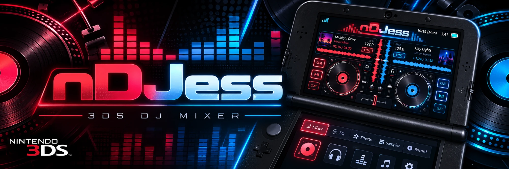
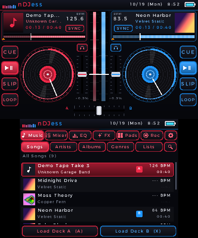

<p align="center"></p>

# nDJess

A two-deck DJ mixer for the Nintendo 3DS. Load MP3s from your SD card onto two turntables and
mix them. You get scratching, pitch faders, BPM sync, EQ, filters, effects, loops, hot cues, a
sampler and recording.

<p align="center"></p>

## Features

- **Two decks** with spinning platters, scrolling waveforms, a whole-track overview (tap it to
  seek), CUE, play/pause, SLIP, LOOP and SYNC.
- **Scratching:** touch the record to scratch, or nudge the tempo with its rim. You can also hold
  **L** / **R** and use the Circle Pad.
- **Mixer:** channel faders, 3-band EQ (high, mid, low), a filter knob, headphone cue, a
  crossfader with an adjustable curve, and master meters.
- **EQ page:** large band faders with KILL switches, plus gain and filter.
- **Effects page:** zoomed waveforms with a beat grid, 4 hot cues, beat-sized loops (1/4 to 32
  beats, snapped to the beat), and Echo, Flanger, Crush and Gate effects with an amount control.
- **BPM detection and sync:** every loaded song is analysed in the background. SYNC matches its
  tempo and lines up the beats. BPMs are remembered and shown in the library.
- **Sampler:** four pads (Air Horn, Siren, Boom, Laser). Replace them with your own sounds:
  `sdmc:/3ds/nDJess/samples/A.wav` to `D.wav` (16-bit PCM, up to 10 seconds).
- **Recording:** records the master output to WAV in `sdmc:/3ds/nDJess/recordings/`.
- **Library:** Songs (with search), Artists, Albums, Genres and Playlists (`.m3u`), from your
  ID3 tags and cover art. It uses the same `sdmc:/MP3` folder as nTapeDeck.
- **Settings:** master volume, crossfader curve, Headphone Preview (cued decks in the left ear,
  master in the right), Auto Gain, pitch range (±8/16/50%), sampler volume, scratch mode and
  stick speed. **Deck colors** can be changed with presets or RGB sliders and are saved; "Reset to
  default colors" brings back red and blue.
- **SELECT swaps the screens,** so the decks move to the touch screen and you can play the
  turntables by hand.
- Music keeps playing with the lid closed.

## Controls

| Button | Action |
|---|---|
| SELECT | Swap screens (decks on the touch screen / on top) |
| Hold L / R / both | Grab deck A / B / both turntables |
| Circle Pad (while holding L/R) | Scratch. **Velocity** mode: push left/right to drag the record back/forth; centered holds it still. **Spin** mode: turn the stick round |
| L/R + A / B / X / Y | Play-pause / Cue / Sync / Loop on that deck |
| L/R + Up / Down | Pitch +0.5% / -0.5% |
| L/R + Left / Right | Nudge (pitch bend) |
| D-Pad Left / Right | Previous / next page |
| ZL / ZR, C-Stick (New 3DS) | Crossfader |
| START | Go to the Library (in the Library: search) |
| **Library:** Up/Down, A, X, B, Y | Move, load on deck A (or open), load on deck B, back, next category |
| **Sampler:** A / B / X / Y | Pads A / B / C / D |
| **Record:** A | Start / stop recording |
| **Settings:** Up/Down, A / B, X / Y | Item, change value, section |

On the touch screen: knobs and faders follow your drag, and double-tapping one resets it.
Hold a hot cue for about a second to clear it.

## Install

You need a 3DS with custom firmware (Luma3DS).

1. Copy `nDJess.3dsx` to `sdmc:/3ds/`, or install `nDJess.cia` with FBI.
2. Put your music in `sdmc:/MP3/`. Subfolders are fine.
3. Sound needs a DSP firmware dump at `sdmc:/3ds/dspfirm.cdc`. If you've never made one, run
   [DSP1](https://github.com/zoogie/DSP1) once.

Settings, the BPM cache, recordings and custom samples live in `sdmc:/3ds/nDJess/`.

## Building

Install [devkitPro](https://devkitpro.org/wiki/Getting_Started) with the `3ds-dev` group, then:

```sh
make
```

This produces `nDJess.3dsx`. `sh tools/build-cia.sh` packages `nDJess.cia` (it needs `makerom`
and `bannertool`); the GitHub workflow does both on every push.

`make AUTOTEST=1` builds `nDJess-test.3dsx`, a self-test that loads two songs, walks every page
and saves screenshots to `sdmc:/3ds/nDJess/shots/`. The screenshots in `docs/screenshots` were
made that way in the [Azahar](https://azahar-emu.org) emulator.

## Notes

- Pitch changes speed and key together, like vinyl (no key lock).
- BPM detection looks between 80 and 175 BPM, so drum & bass may show as half time (87 for
  174). SYNC still matches it.
- Old 3DS models have less CPU to spare. If you hear dropouts there, keep FX to one deck.

## Credits

- MP3 decoding: [minimp3](https://github.com/lieff/minimp3) (CC0)
- Image decoding: [stb_image](https://github.com/nothings/stb) (public domain)
- Library, art loader and drawing helpers from nTapeDeck 3DS
- Built with [libctru](https://github.com/devkitPro/libctru), citro2d and citro3d
- App and artwork by Nova White (novaMajora) & Jessica White

*made in honor of my wife. i love you always*
